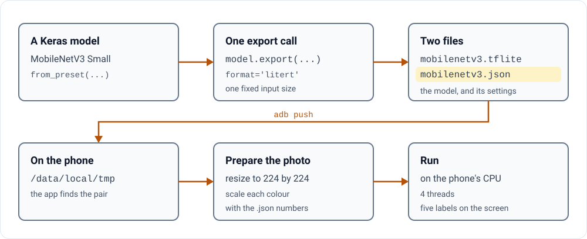

# Keras On-Device

Pick a photo, and this Android app runs a Keras image classifier on it, on the phone, with no server. It is a demo
app with a step-by-step guide, not a product: no model comes with it, so you export one yourself and copy it to the
phone.

<p>
<picture>
  <source media="(prefers-color-scheme: dark) and (max-width: 600px)" srcset="assets/path-narrow-dark.svg">
  <source media="(max-width: 600px)" srcset="assets/path-narrow-light.svg">
  <source media="(prefers-color-scheme: dark)" srcset="assets/path-dark.svg">
  
</picture>
</p>

Writing the guide found bugs that are still in the app: the top-five code drops the best score each time it holds
six, so the screen shows the five least likely labels.

**[Start the guide: one model on your phone →](docs/01-export-a-vision-model.md)**

## What you get

- **One model, start to finish.** One export call in Python to LiteRT, the format once called TensorFlow Lite; one
  small settings file; and four commands that copy the files to the phone and install the app.
- **A way to check the phone's answer.** Get the right answer in Python, check the exported file against it, then
  hold the phone to the same answer.
- **The traps before you hit them.** Five ways an export breaks, each with the public issue or pull request behind it.
- **Six screens to start from.** Classification, object detection, segmentation and depth, each showing how long the
  run took in milliseconds; a Gemma model that writes text; and a screen that only checks that a model which reads
  images can start.

## Try it

You export the model and copy it to the phone yourself. Save the settings file from
[part 1](docs/01-export-a-vision-model.md#2-tell-the-app-how-to-feed-it) as `/tmp/mobilenetv3.json`, then:

```bash
KERAS_BACKEND=torch python -c "
import keras_hub, torch
m = keras_hub.models.MobileNetImageClassifier.from_preset('mobilenet_v3_small_100_imagenet')
m.export('/tmp/mobilenetv3.tflite', format='litert', input_signature=[torch.randn(1,224,224,3)])
"
adb push /tmp/mobilenetv3.tflite /data/local/tmp/
adb push /tmp/mobilenetv3.json /data/local/tmp/
adb push app/src/androidTest/assets/models/*.txt /data/local/tmp/
./gradlew installDebug
```

`from_preset` loads a pretrained model by name from KerasHub, the Keras library of ready-made models.
`input_signature` fixes the input to one 224 by 224 colour photo, because an export on the PyTorch backend needs one
fixed size. Then open Classification, pick a photo and tap Run. These commands come from this repository and the
public docs it links; they were not re-run for this page.

You need a recent Android Studio (Ladybug or newer), Android SDK 36, JDK 21, the Python packages from
[part 1](docs/01-export-a-vision-model.md#1-export-the-model), and a phone that `adb` can reach.

## What the guide found

Besides the top-five bug, the code as of
[3 July 2026](https://github.com/pctablet505/keras-ondevice-android/tree/b8d3e2f1baeb5f9d13697e6a0ee5e1f646f6da09) has
two tests that cannot catch a wrong answer (one only counts the labels), a sample settings file whose numbers do not
fit this model, and a label file of placeholder names. [Part 1](docs/01-export-a-vision-model.md#before-you-trust-the-list) and
[part 2](docs/02-check-against-the-notebook.md#two-tests-that-could-not-fail) show each one in the code.

## Limits

The vision screens run on the CPU only, with TensorFlow Lite's older Interpreter API, which the
[LiteRT Android page](https://ai.google.dev/edge/litert/android) calls "maintained for backward compatibility". The
guide covers the vision models; making the model files for the two Gemma screens is not covered.

## The guide

- [Part 1: export a KerasHub vision model and run it on Android](docs/01-export-a-vision-model.md): the whole path,
  with the numbers the model needs.
- [Part 2: check the phone's answer against the notebook](docs/02-check-against-the-notebook.md): why two of this
  app's tests cannot catch a wrong answer, and how to write one that can.
- [Part 3: where conversion breaks, with the evidence](docs/03-traps.md): five traps, each with the public pull request
  or issue behind it.
- [Build, test and export: the reference](docs/reference.md): every build, test and export command, and how the code
  is laid out.

## Licence

Apache-2.0, see [LICENSE](LICENSE).

---

<picture><source media="(prefers-color-scheme: dark)" srcset="assets/mark-dark.svg"></picture>
<sub>Built by [pctablet505](https://github.com/pctablet505).</sub>
