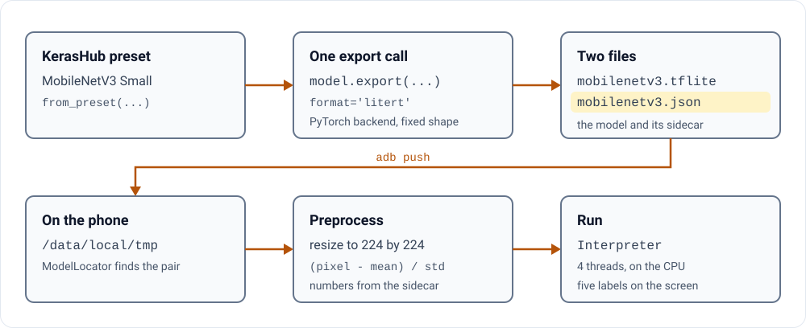

# Export a KerasHub vision model and run it on Android

**A Keras model on a phone with one export call, not a rewrite.**

This page takes one KerasHub image classifier, MobileNetV3, to an Android phone. You need one export call in
Python, one JSON file for the app, and four commands for the phone. The format is LiteRT, once called
TensorFlow Lite, and the file still ends in `.tflite`.

<p>
<picture>
  <source media="(prefers-color-scheme: dark) and (max-width: 600px)" srcset="assets/01-diagram-narrow-dark.svg">
  <source media="(max-width: 600px)" srcset="assets/01-diagram-narrow-light.svg">
  <source media="(prefers-color-scheme: dark)" srcset="assets/01-diagram-dark.svg">
  
</picture>
</p>

## Is it for you?

For an Android developer, or an ML engineer with a Keras model, who wants it on a real phone.

What it is not:

- **Not a tour of the export API.** The [keras.io LiteRT guide](https://keras.io/guides/litert_export/) covers
  model types, quantization and the signature runner.
- **Not tuned.** The app runs the model on the CPU, through the Interpreter API. The
  [LiteRT Android page](https://ai.google.dev/edge/litert/android) calls that API "maintained for backward
  compatibility".

## 1. Export the model

The keras.io guide installs Keras, KerasHub and litert-torch from their main branches, because the export path is
still moving. On 22 October 2026 that failed for this model: with keras 3.16.0, keras-hub 0.33.0.dev0 and
litert-torch 0.11.0 from the main branches, the export below stopped with
`'tfl.batch_matmul' op found invalid output rank, expected 3 but got 4`. The released versions worked. Install
PyTorch first (the CPU build is enough), then pin them:

```bash
pip install torch --index-url https://download.pytorch.org/whl/cpu
pip install keras==3.15.1 keras-hub==0.32.0 litert-torch==0.10.0 ai-edge-litert==2.3.0
```

Then one call exports the model. This is the export command from this repository's README:

```bash
KERAS_BACKEND=torch python -c "
import keras_hub, torch
m = keras_hub.models.MobileNetImageClassifier.from_preset('mobilenet_v3_small_100_imagenet')
m.export('/tmp/mobilenetv3.tflite', format='litert', input_signature=[torch.randn(1,224,224,3)])
"
```

On 22 October 2026, with the pinned versions and on a computer's CPU, it wrote a 10,255,480-byte
`mobilenetv3.tflite`. Two parts of it matter:

- `KERAS_BACKEND=torch` picks the PyTorch backend. The keras.io guide uses it because its output runs on the new
  LiteRT Android runtime without flex ops.
- `input_signature` fixes one shape: one image, 224 by 224, three channels. The PyTorch path needs a fixed shape
  ([keras#22997](https://github.com/keras-team/keras/pull/22997)).

## 2. Tell the app how to feed it

The exported file starts after preprocessing. KerasHub's own source says so: calling a model directly "does not
apply preprocessing" ([pipeline_model.py](https://github.com/keras-team/keras-hub/blob/3ba52a2fa10a841633bc8acb06e6fa0195a00077/keras_hub/src/utils/pipeline_model.py#L537-L553)).
So the app resizes and normalizes each photo itself
([ImagePreprocessor.kt](../app/src/main/java/com/example/kerasondevice/data/preprocessing/ImagePreprocessor.kt)).
It reads the numbers from a JSON sidecar beside the model. A model with no sidecar is skipped
([ModelLocator.kt](../app/src/main/java/com/example/kerasondevice/domain/model/ModelLocator.kt)).

This preset's numbers come from its own image converter
([preprocessor.json](https://huggingface.co/keras/mobilenet_v3_small_100_imagenet/blob/0c0c8625121a1725a05a0ec7d23f0ed22286b3a2/preprocessor.json)):
a `scale` and an `offset` for each colour channel. In the sidecar's terms, on pixels from 0 to 255, `mean` is
`-offset / scale` and `std` is `1 / scale`. Save this as `/tmp/mobilenetv3.json`:

```json
{
  "task": "image_classification",
  "image_width": 224,
  "image_height": 224,
  "normalization": {"mean": [123.675, 116.28, 103.53], "std": [58.395, 57.12, 57.375]},
  "labels": "imagenet_labels.txt",
  "num_classes": 1000
}
```

The sidecar in the app's test assets is marked as a placeholder, and it uses 127.5 for both numbers. That maps
pixels to the range -1 to 1, which is not the input this preset expects. It does not always change the answer: on a
public-domain photo of a California quail
([U.S. Fish and Wildlife Service, via Wikimedia Commons](https://commons.wikimedia.org/wiki/File:California_Quail_(9405494428)_(cropped).jpg),
cropped square), the exported file, fed the way the app feeds it, still ranks quail first. Its raw score, before any
softmax, falls from 10.11 with the preset's numbers to 9.72 with the placeholder's. A wrong number that leaves the top
answer alone is easy to ship.

## 3. Put both on the phone

The app looks for models in its own files folder, then its external files folder, then `/data/local/tmp`. The
README stages models in `/data/local/tmp` with `adb push`, and Gradle's `installDebug` builds the app and installs
it on the connected phone:

```bash
adb push /tmp/mobilenetv3.tflite /data/local/tmp/
adb push /tmp/mobilenetv3.json /data/local/tmp/
adb push app/src/androidTest/assets/models/*.txt /data/local/tmp/
./gradlew installDebug
```

The third line copies the label files. The ImageNet one holds placeholders, `class_0` to `class_999`, so the app
shows class numbers. `keras_hub.utils.imagenet_id_to_name` turns a number into a name.

Open the app, choose Classification, and pick a photo. On 22 October 2026 the app built with Gradle 9.1.0
(`./gradlew assembleDebug`, 1 min 38 s); it was not tested on a phone for this page.

## Before you trust the list

When I read the code for this page, I found that the five labels are the wrong five. The queue keeps the highest
score at its head. Each time it holds six, `poll()` removes that head
([lines 64 to 72](https://github.com/pctablet505/keras-ondevice-android/blob/b8d3e2f1baeb5f9d13697e6a0ee5e1f646f6da09/app/src/main/java/com/example/kerasondevice/inference/tasks/ImageClassificationTask.kt#L64-L72)).
So the screen shows the five least likely classes. For the quail photo above, the same file run on a computer's CPU,
with the app's preprocessing and its top-five code copied into Python, gives the app's list as classes 50, 329, 389,
758 and 328: American alligator, sea cucumber, barracouta, reel and sea urchin. The real top five for the same input
are quail, prairie chicken, partridge, black grouse and ruffed grouse. The test for this screen checks only that one to five
labels come back
([line 66](https://github.com/pctablet505/keras-ondevice-android/blob/b8d3e2f1baeb5f9d13697e6a0ee5e1f646f6da09/app/src/androidTest/java/com/example/kerasondevice/ClassificationE2ETest.kt#L66)).
It cannot see this.

Why a check like that cannot fail, and the one that can, is the next page.

**[Next: check the phone's answer against the notebook →](02-check-against-the-notebook.md)**

---

<picture><source media="(prefers-color-scheme: dark)" srcset="../assets/mark-dark.svg"></picture>
<sub>Part 1 of the [Keras On-Device guide](../README.md#the-guide). Built by [pctablet505](https://github.com/pctablet505).</sub>
