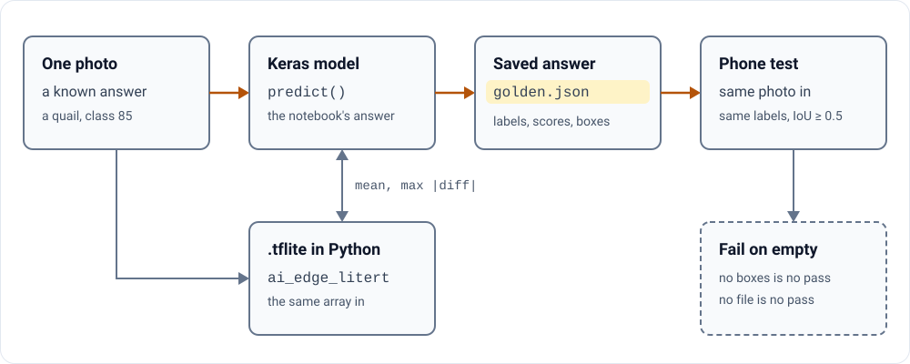

# Check the phone's answer against the notebook

**Check the phone's answer against the notebook, not by eye.**

A test proves something only if it could have failed. Two tests in my own app could not. This page builds one
that can: the notebook's answer, the exported file's answer, and the phone held to both.

<picture>
<source media="(prefers-color-scheme: dark)" srcset="assets/02-diagram-dark.svg">

</picture>

## Two tests that could not fail

Both are in this repository at commit
[b8d3e2f](https://github.com/pctablet505/keras-ondevice-android/tree/b8d3e2f1baeb5f9d13697e6a0ee5e1f646f6da09).

- **The classification test counts the labels.** It asks for one to five of them, not which ones
  ([line 66](https://github.com/pctablet505/keras-ondevice-android/blob/b8d3e2f1baeb5f9d13697e6a0ee5e1f646f6da09/app/src/androidTest/java/com/example/kerasondevice/ClassificationE2ETest.kt#L66)).
  So it passes on the five least likely classes from [part 1](01-export-a-vision-model.md#before-you-trust-the-list).
- **The detection test reads an empty answer.** Its golden file holds no boxes, only a note:
  `Golden generation skipped: No module named 'ai_edge_litert'`
  ([detection_golden.json](https://github.com/pctablet505/keras-ondevice-android/blob/b8d3e2f1baeb5f9d13697e6a0ee5e1f646f6da09/app/src/androidTest/assets/golden/detection_golden.json)).
  An empty list of boxes matches any output
  ([lines 130 to 131](https://github.com/pctablet505/keras-ondevice-android/blob/b8d3e2f1baeb5f9d13697e6a0ee5e1f646f6da09/app/src/androidTest/java/com/example/kerasondevice/DetectionE2ETest.kt#L130-L131)).
  The script that should write the answer writes a placeholder instead, and carries on
  ([prepare_test_assets.py](https://github.com/pctablet505/keras-ondevice-android/blob/b8d3e2f1baeb5f9d13697e6a0ee5e1f646f6da09/scripts/prepare_test_assets.py#L86-L90)).

Both tests use one image: three flat shapes on a blue ground. It holds no ImageNet class and no COCO object, so no
answer to it is wrong.

## 1. Get the notebook's answer

Start from a real photo with a known answer. KerasHub's own example uses a California quail, and "quail" is ImageNet
class 85 ([imagenet_utils.py](https://github.com/keras-team/keras-hub/blob/3ba52a2fa10a841633bc8acb06e6fa0195a00077/keras_hub/src/utils/imagenet/imagenet_utils.py)):

```python
image_url = "https://upload.wikimedia.org/wikipedia/commons/a/aa/California_quail.jpg"
image_path = keras.utils.get_file(origin=image_url)
image = keras.utils.load_img(image_path)
classifier = keras_hub.models.ImageClassifier.from_preset(
    "resnet_50_imagenet",
    activation="softmax",
)
preds = classifier.predict(np.array([image]))
top_labels = keras_hub.utils.decode_imagenet_predictions(preds)
```

Put the preset you exported in place of `resnet_50_imagenet`. `predict()` runs the preset's own preprocessing, so
this is the answer the model was built to give. Keep the five labels and their scores.

## 2. Check the exported file before the phone

Feed the `.tflite` file the array the Keras model sees after preprocessing. KerasHub's own hint for that step is
`model(model.preprocessor(x))`
([pipeline_model.py](https://github.com/keras-team/keras-hub/blob/3ba52a2fa10a841633bc8acb06e6fa0195a00077/keras_hub/src/utils/pipeline_model.py#L537-L553)).
Then run the file with the interpreter code from the
[keras.io guide](https://keras.io/guides/litert_export/), which calls `tf.lite.Interpreter` deprecated:

```python
from ai_edge_litert.interpreter import Interpreter

interpreter = Interpreter(model_path="model.tflite")
interpreter.allocate_tensors()

input_details = interpreter.get_input_details()
output_details = interpreter.get_output_details()

print("Input shape :", input_details[0]["shape"])
print("Output shape:", output_details[0]["shape"])

interpreter.set_tensor(input_details[0]["index"], sample_input)
interpreter.invoke()
output = interpreter.get_tensor(output_details[0]["index"])
print("Inference output shape:", output.shape)
```

Compare the two outputs the way KerasHub's own export tests do
([test_case.py](https://github.com/keras-team/keras-hub/blob/3ba52a2fa10a841633bc8acb06e6fa0195a00077/keras_hub/src/tests/test_case.py#L1038-L1058)):

```python
abs_diff = np.abs(keras_val - litert_val)
mean_abs_diff = np.mean(abs_diff)
max_abs_diff = np.max(abs_diff)
```

Its strict mode allows a tolerance of 1e-6. Its statistical mode holds the mean and the largest difference under a
threshold set for each output. Some models only pass that way: "within tolerance rather than exact match"
([keras-hub#2698](https://github.com/keras-team/keras-hub/pull/2698)).

## 3. Hold the phone to the saved answer

Save the answer next to the test: the five labels and their scores. For detection, save the boxes as `label`,
`score`, `x1`, `y1`, `x2`, `y2`: the keys the detection test already reads. Push the same photo to the phone.

The detection test already compares the right way: the same label, and a box overlap (IoU) of 0.5 or more
([DetectionE2ETest.kt](https://github.com/pctablet505/keras-ondevice-android/blob/b8d3e2f1baeb5f9d13697e6a0ee5e1f646f6da09/app/src/androidTest/java/com/example/kerasondevice/DetectionE2ETest.kt#L126-L138)).
Two guards turn it into a test that can fail:

- **An empty or missing answer fails.** It never counts as a pass.
- **The same pixels go in.** The preset crops the photo to a square before it resizes it
  ([preprocessor.json](https://huggingface.co/keras/mobilenet_v3_small_100_imagenet/blob/0c0c8625121a1725a05a0ec7d23f0ed22286b3a2/preprocessor.json)),
  and the app stretches it. Use a square photo, or crop it first.

## What I have not solved

How close is close enough once a model is quantized? KerasHub's thresholds are set by hand, per model and per
output. I do not have a rule for picking one yet.

**[Next: the traps, each with its public evidence →](03-traps.md)**

---

<picture><source media="(prefers-color-scheme: dark)" srcset="../assets/mark-dark.svg"></picture>
<sub>Part 2 of the [Keras On-Device guide](../README.md#the-guide). Built by [pctablet505](https://github.com/pctablet505).</sub>
