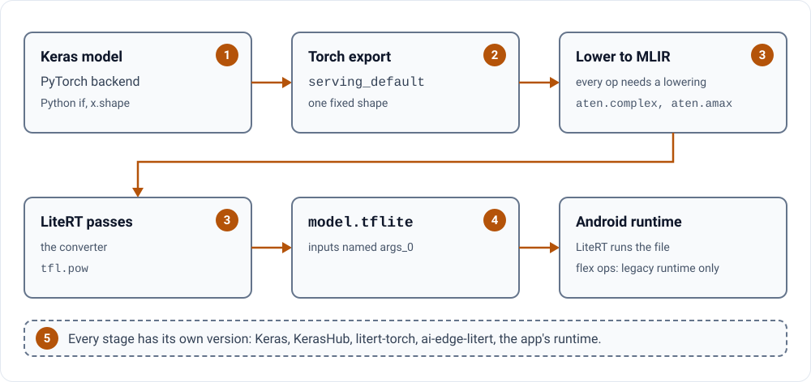

# Where conversion breaks, with the evidence

**Each trap with the public issue behind it, not folklore.**

Here are five ways a Keras export to LiteRT breaks. Each has a public record: a merged pull request, an issue, or a
test that is still switched off. Read the record before you lose a day to it.

<picture>
<source media="(prefers-color-scheme: dark)" srcset="assets/03-diagram-dark.svg">

</picture>

## 1. Python decides what the graph holds

Export turns your Python into a graph. A Python `if` on a tensor, or a size read with `x.shape`, can break that
step or freeze one case.
Two merged fixes show the cure: `x.shape[position]` became `ops.shape(x)[position]`
([keras-hub#2466](https://github.com/keras-team/keras-hub/pull/2466)), and a Python `if`/`else` was removed by
building the tensor so that one token gives an empty one, "avoiding the need for a Python conditional"
([keras-hub#2467](https://github.com/keras-team/keras-hub/pull/2467)). The DeepLabV3 test
is still skipped with this reason: "symbolic tf.Tensor used as a Python bool"
([test](https://github.com/keras-team/keras-hub/blob/3ba52a2fa10a841633bc8acb06e6fa0195a00077/keras_hub/src/models/deeplab_v3/deeplab_v3_segmenter_test.py#L74-L77)).

## 2. The shape is fixed at export

You see a shape guard error during export. On the PyTorch backend, dynamic shapes are not supported, and the input
signature must be fixed
([keras#22997](https://github.com/keras-team/keras/pull/22997)). KerasHub still marks its D-Fine export test as an
expected failure: "D-FINE's multi-scale features hit a torch.export shape guard"
([test](https://github.com/keras-team/keras-hub/blob/3ba52a2fa10a841633bc8acb06e6fa0195a00077/keras_hub/src/models/d_fine/d_fine_object_detector_test.py#L177-L180)).

Export at one fixed shape. For another batch size, resize the input at run time with `resize_tensor_input()`, as
the [keras.io guide](https://keras.io/guides/litert_export/) shows. This app takes D-Fine down a different road: a
TensorFlow SavedModel, then the converter with `SELECT_TF_OPS` ([export steps](reference.md#model-exports)).

## 3. An op has no lowering

The export stops at one op name. When KerasHub switched its export tests on for PyTorch, it marked 11 models as
expected failures ([keras-hub#2698](https://github.com/keras-team/keras-hub/pull/2698)). Each has a one-line reason. Three of them:

- F-Net: "litert-torch has no lowering for aten.complex (from ops.fft2)"
- Mixtral, Qwen-MoE and Qwen3-MoE: "litert-torch cannot lower aten._assert_async from MoE routing"
- VAE: "VAE's pow ops fail TFLite legalization (tfl.pow)"

Check that list before you start. The guide's fallback is the TensorFlow backend, whose flex ops "are not supported
by the new LiteRT Android runtime". They need the legacy runtime and its `tensorflow-lite-select-tf-ops` package,
which this app ships ([app/build.gradle.kts](../app/build.gradle.kts)).

## 4. The input names change

Your app asks for an input by name, and the file calls it `args_0`. litert-torch flattened dict inputs to generic
names ([litert-torch#1022](https://github.com/google-ai-edge/litert-torch/issues/1022), closed 2026-06-04). The
original keys survive only with litert-torch newer than 0.9.1
([keras#23053](https://github.com/keras-team/keras/pull/23053)). Print the names before you write app code. This is
the guide's line for it, and what it printed for this app's MobileNetV3 file on 22 October 2026:

```python
print("Signatures:", interpreter.get_signature_list())
# Signatures: {'serving_default': {'inputs': ['args_0'], 'outputs': ['output_0']}}
```

## 5. The toolchain moves under you

In February 2026, KerasHub switched off all its LiteRT export tests: TensorFlow 2.20 had deprecated `tf.lite`
([keras-hub#2573](https://github.com/keras-team/keras-hub/pull/2573)). They came back in July for the PyTorch
backend only, with Keras 3.15 or newer
([keras-hub#2698](https://github.com/keras-team/keras-hub/pull/2698)). Keras 3 with TensorFlow 2.20 and Python 3.13
crashed during export until [keras#22816](https://github.com/keras-team/keras/pull/22816).

It moved again on 22 October 2026. Installed from the main branches, as the keras.io guide does it (keras 3.16.0,
keras-hub 0.33.0.dev0, litert-torch 0.11.0), the part 1 export failed in the converter passes with
`'tfl.batch_matmul' op found invalid output rank, expected 3 but got 4`. The released versions of the day before,
keras 3.15.1, keras-hub 0.32.0, litert-torch 0.10.0 and ai-edge-litert 2.3.0, exported the same model.

Write down the versions that worked for you, and the date, next to the file:

```bash
pip freeze | grep -iE "keras|litert" > export-versions.txt
```

## The one I cannot close yet

KerasHub's DeepLabV3 export test is still skipped on master. This app exports a DeepLabV3 preset on the same
PyTorch backend ([export steps](reference.md#model-exports)). One of the two is out of date, or they differ in a way I have not found. The
22 October run covered MobileNetV3 only, so this one is still open.

**[New here? Start with part 1: one model on a phone →](01-export-a-vision-model.md)**

---

<picture><source media="(prefers-color-scheme: dark)" srcset="../assets/mark-dark.svg"></picture>
<sub>Part 3 of the [Keras On-Device guide](../README.md#the-guide). Built by [pctablet505](https://github.com/pctablet505).</sub>
